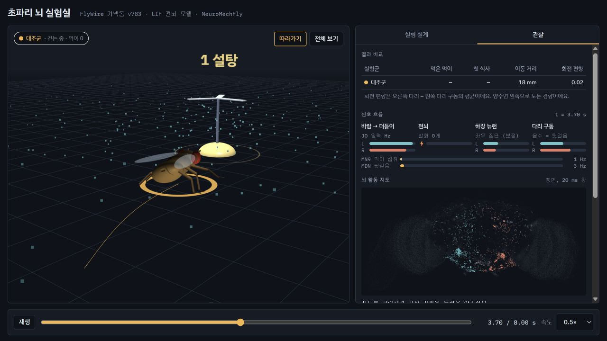
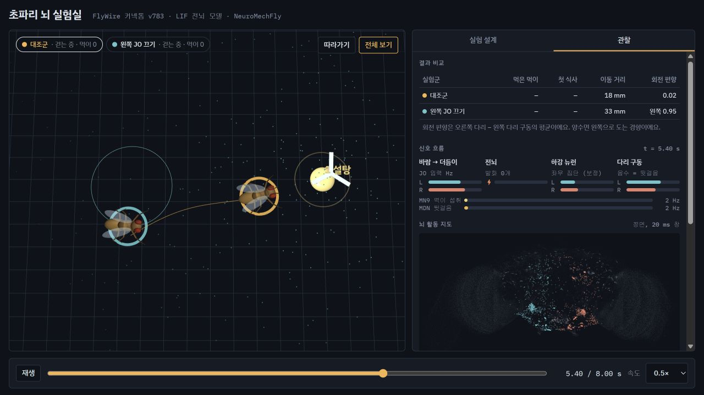
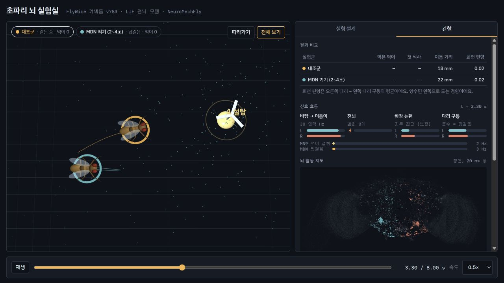
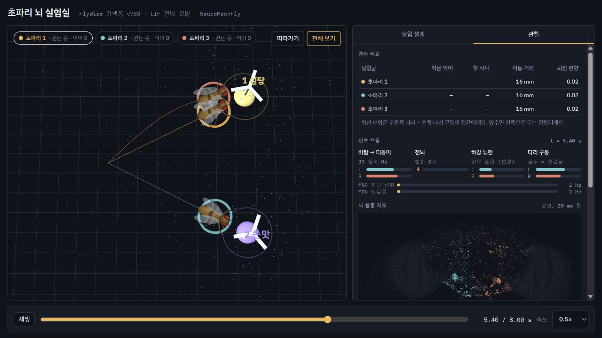
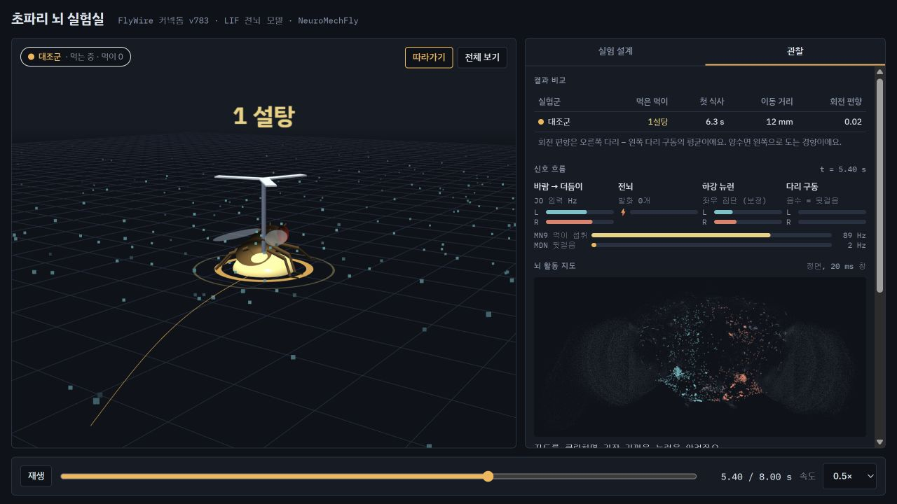
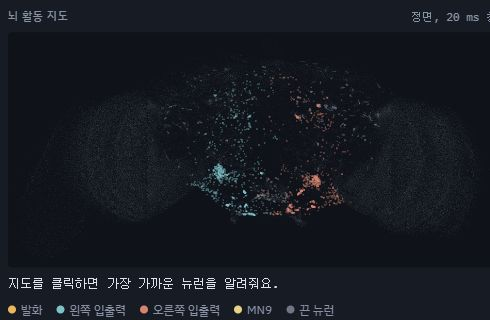

# 초파리 뇌 실험실

실제 초파리 뇌 배선도(FlyWire 커넥톰, 뉴런 138,639개, 연결 1,509만 개)를 GPU에서 스파이킹 뉴런 네트워크로 돌리고,
그 출력으로 3D 초파리 몸(NeuroMechFly / MuJoCo)을 걷게 하는 실험실이에요. 브라우저에서 뉴런을 켜고 끄는 실험을 설계하고,
여러 마리를 동시에 달리게 해서 결과를 비교할 수 있어요.



아래 이미지는 화면 구성과 조작 흐름을 보여주는 예시 데이터 기반 캡처예요.
초파리 몸체는 시각화용 근사 모델이고, 뇌 지도는 FlyWire 주석의 고정 좌표를 사용해요.

```
선풍기 바람 → 더듬이 존스턴 기관(JO) 뉴런 → [전뇌 LIF 모델] → 하강 뉴런 좌/우 집단 → CPG 걷기 컨트롤러 → 몸
먹이 위    → 설탕 미각 뉴런                → [전뇌 LIF 모델] → MN9(먹이 섭취 운동뉴런) → 멈춰서 먹기
                                             [전뇌 LIF 모델] → MDN(뒷걸음 하강 뉴런)   → 뒤로 걷기
```

## 화면 살펴보기

### 두 마리의 조건 비교

대조군과 왼쪽 JO 입력을 끈 초파리를 같은 아레나에 놓고 비교하는 구성이에요.
색으로 실험군을 구분하고, 지나온 궤적과 결과 비교표를 함께 볼 수 있어요.



### MDN 자극과 뒷걸음

MDN을 2~4초 동안 켜는 조건이에요. 해당 실험군을 선택하면 뒷걸음 상태와 MDN 발화율,
좌우 다리 구동 신호를 함께 살펴볼 수 있어요.



### 세 마리의 먹이 선택

설탕과 쓴맛 먹이를 함께 놓은 자유 선택 아레나예요. 세 마리의 이동 경로를 다른 색으로 표시하고,
먹이 위치와 각 초파리의 움직임을 전체 보기로 관찰해요.



### 먹이 섭취

한 마리가 먹이 위에서 멈춰 먹는 장면이에요. MN9 신호와 다리 구동 상태를 함께 표시해서
걷는 상태와 먹는 상태를 구분할 수 있어요.



### 뇌 활동 지도

뉴런의 위치는 고정되어 있고, 실행 기록에서 발화한 뉴런의 밝기만 재생 시점에 맞춰 바뀌어요.
발화와 좌우 입출력, MN9, 끈 뉴런을 색으로 구분하고, 지도를 누르면 가까운 뉴런의 정보를 살펴볼 수 있어요.



## 실행

가상환경은 한글 경로 문제를 피하려고 OneDrive 밖(`C:\Users\70sou\.venvs\flies`, Python 3.12)에 있어요.

```bash
C:/Users/70sou/.venvs/flies/Scripts/python.exe server.py
```

그다음 http://localhost:8765 를 열면 돼요.

- **실험 설계** 탭: 예시 실험을 고르거나, 먹이를 바닥에 클릭해서 놓고, 초파리(실험군)마다 뉴런 조작을 추가해요.
  - 켜기: 셀 타입(예: `MDN`, `DNa02`)이나 감각 그룹(`JO`, `설탕`, `냄새` …)을 정해진 시간 동안 포아송 자극
  - 끄기: 해당 뉴런의 출력 시냅스를 모두 차단 (논문의 silencing과 같은 방식)
- **관찰** 탭: 결과 비교표, 신호 흐름, 뇌 활동 지도(클릭하면 뉴런 정체 표시), 시간 기록, 주요 하강 뉴런 발화율

실험 결과는 `runs/`에 저장되고, "이전 실행"에서 다시 열 수 있어요.

### 괴짜 실험 도구

| 도구 | 설명 |
|---|---|
| 먹이 종류 | 먹이마다 밟았을 때 자극할 뉴런을 정해요 (`설탕`, `쓴맛`, `MDN` "뒷걸음 버섯", `보상 도파민` "도파민 사탕" …). `효과`초 동안 여운이 남아요. 설탕만 실제로 먹을 수 있어요 |
| 자유 선택 아레나 | 모든 선풍기가 동시에 돌고, 가까운 선풍기 바람이 더 세요. 초파리가 어느 먹이로 갈지 고르게 돼요 |
| 더듬이 좌우 바꾸기 | 왼쪽 바람이 오른쪽 JO 입력으로 들어가요 |
| 뇌 둘 (평균) | 몸 하나에 뇌 두 개. 둘 다 같은 감각을 받고, 하강 뉴런 출력을 평균해서 다리를 움직여요. 뇌마다 조작을 따로 줄 수 있어요 |
| 뇌 둘 (분리) | 뇌 A는 왼쪽 다리, 뇌 B는 오른쪽 다리만 조종해요 |
| 신경조절 뉴런 그룹 | `보상 도파민`(PAM 307개), `처벌 도파민`(PPL1 16개), `도파민 전체`, `옥토파민`(OA 43개, 스트레스), `세로토닌`(5-HT 18개), `GABA 억제`(약 15,000개) |

신경조절 "주입"은 해당 뉴런들을 켜거나 끄는 방식이에요. 이 모델에서 도파민·옥토파민·세로토닌 시냅스는 빠른 흥분성 시냅스로만 표현되고,
실제 뇌의 느린 신경조절 효과는 없어요. `scripts/probe_drugs.py`로 측정한 효과(바람이 왼쪽에서 올 때, 0.5초):

| 조작 | 뇌 전체 활동 | 좌/우 하강 뉴런 | 눈에 띄는 점 |
|---|---|---|---|
| 대조군 | 14k Hz | 204 / 152 | |
| 보상 도파민 100Hz | 50k | 918 / 392 | MDN 30Hz → 뒷걸음 |
| 처벌 도파민 100Hz | 616k | 2864 / 3374 | 16개 뉴런만으로 뇌 폭주 |
| 옥토파민 100Hz | 57k | 592 / 904 | 좌우 조향이 뒤집힘 |
| 세로토닌 100Hz | 61k | 980 / 974 | 좌우가 같아져 방향 상실 |
| GABA 억제 끄기 | 16k | 696 / 350 | 발작 없음, 조향이 더 예민해짐 |

예시 실험은 `viewer/presets.json`에 있고, 서버가 켜진 상태에서 `python scripts/run_presets.py [이름 일부 …]`로 한꺼번에 돌릴 수 있어요.
속도는 RTX 2060 기준 약 `20초 + 시뮬레이션 초 × (4 + 5 × 마리 수)`예요. 예를 들어 6초에 3마리면 약 2분이에요.

## 파일

| 파일 | 내용 |
|---|---|
| `server.py` | 뷰어 제공, 실험 요청 대기열, 결과 저장 |
| `flybrain/brain.py` | Shiu et al. 2024 LIF 모델의 PyTorch GPU 이식. 파라미터 동일, 배치(여러 마리) 병렬, 이벤트 기반 시냅스 전달 |
| `flybrain/experiment.py` | 뇌와 몸의 폐루프 실험 엔진 (실험군별 뉴런 켜기/끄기) |
| `flybrain/neurons.py` | FlyWire v783 셀 타입으로 뉴런 찾기 |
| `viewer/index.html` | 실험실 UI (three.js 3D, 뇌 활동 지도, 기록) |
| `scripts/validate_sugar.py` | 검증: 설탕 뉴런 자극 → MN9 발화 (논문 Fig. 1 재현) |
| `scripts/check_event_driven.py` | 검증: 이벤트 기반 전달이 행렬곱 방식과 스파이크 수까지 똑같은지 |
| `scripts/screen_senses.py` | 감각 종류별로 좌우 정보가 하강 뉴런까지 가는지 스크리닝 |
| `scripts/probe_*.py`, `tune_adapt.py`, `profile_loop.py` | 냄새, 폭주, 신경조절, 피로(적응), 속도 측정 실험 |
| `scripts/run_presets.py` | 예시 실험을 서버 대기열에 한꺼번에 넣기 |

`data/`(커넥톰 약 135MB)와 `runs/`는 git에서 제외돼요. 데이터 받는 곳:
- `Completeness_783.csv`, `Connectivity_783.parquet`: github.com/philshiu/Drosophila_brain_model
- `flywire_annotations_783.tsv`: github.com/flyconnectome/flywire_annotations (`supplemental_files/Supplemental_file1_neuron_annotations.tsv`)

## 실험에서 알게 된 것

- **이 모델에는 두 개의 안정 상태가 있어요.** 약한 자극은 끝나면 바로 조용해지지만, 냄새(ORN 30Hz)나 설탕 뉴런 57개 전체(200Hz) 같은
  강한 자극은 초당 약 86만 스파이크의 "폭주"를 일으키고, 자극을 끊어도 멈추지 않아요. 논문은 1초짜리 자극만 썼기 때문에 드러나지 않았어요.
- 냄새 입력에 좌우 정보가 없어 보였던 것도 이 폭주 때문이에요.
- 피로(스파이크 빈도 적응)를 넣으면 폭주는 약해지지만 멈추지 않고, 설탕 → MN9 같은 정상 반응이 먼저 무너져요. 그래서 기본값은 0(논문 모델 그대로)이에요.
- **바람(JO), 소리, 홑눈, 머리 감각모는 좌우가 뚜렷해요.** 바람은 같은 쪽 하강 뉴런을 켜고(동측 지수 +0.89), 세기에 따라 단계적으로 반응해요.
- 한쪽 JO를 끄면 반대쪽으로 계속 돌아서 먹이를 못 찾아요. 왼쪽과 오른쪽 결과가 거울상으로 나와요.
- 전진(DNp09) 하강 뉴런은 이 감각 입력들로는 켜지지 않아요.

## 사람이 정한 부분 (뇌가 아닌 부분)

- 바람 방향 → 좌/우 JO 발화율로 바꾸는 센서 모델
- 하강 뉴런 → [왼쪽, 오른쪽] 걷기 신호 규칙: 좌우 집단 활동량이 많은 쪽으로 회전, 총량이 속도.
  실험 시작 때 조작하지 않은 뇌로 정면 바람을 줘서 좌우 영점을 보정해요(오른쪽 반응이 약 3배 강해서).
  MDN 발화율이 높으면 뒷걸음, DNp09 발화율은 전진 속도에 더해져요.
- MN9가 20Hz를 넘으면 멈춰서 먹는 규칙, 1.5초 먹으면 다음 먹이로
- 걷기 자체(다리 관절 궤적)는 FlyGym의 CPG 컨트롤러가 만들어요. 커넥톰에는 뇌만 있고 다리를 움직이는 신경절(VNC)은 없어요.
